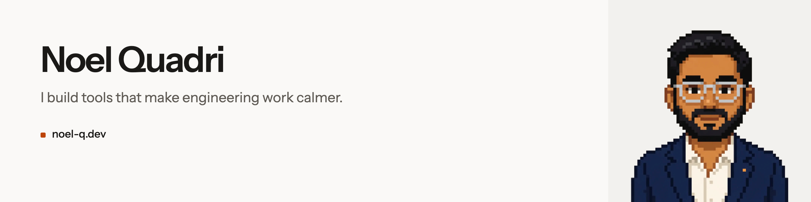
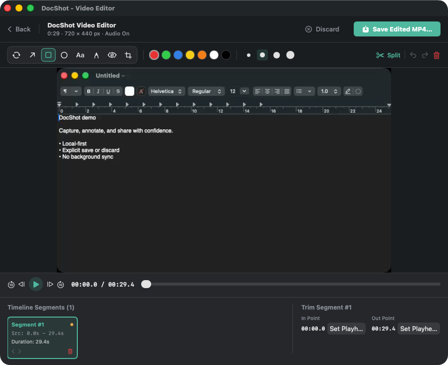
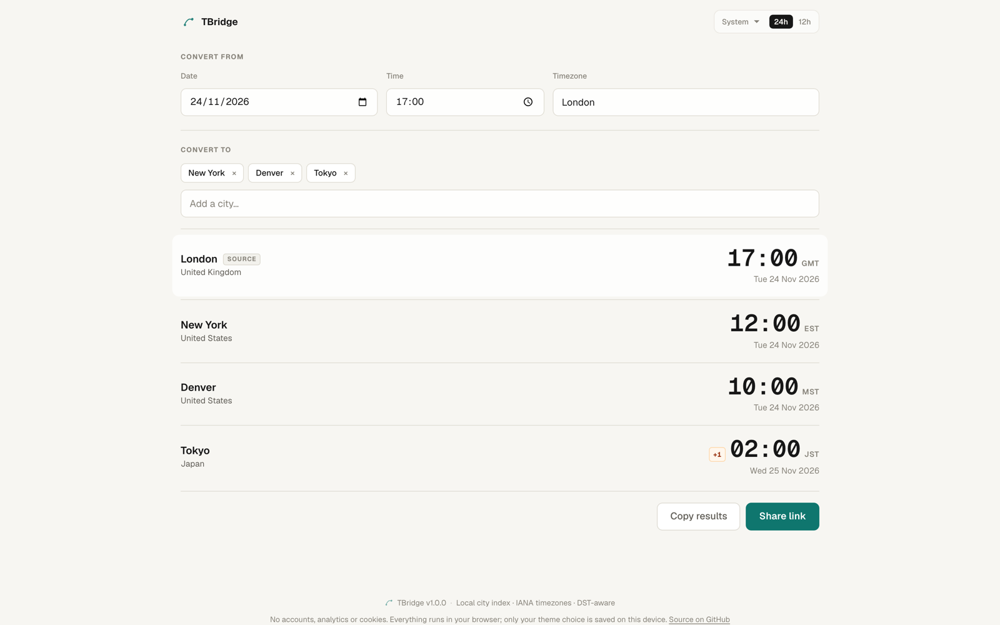

<picture>
  <source media="(prefers-color-scheme: dark)" srcset="./assets/banner-dark.png">
  <source media="(prefers-color-scheme: light)" srcset="./assets/banner-light.png">
  
</picture>

Solutions engineer in London, moving into cloud and platform work. I build tools I use every day, and show each one with what is tested and what is still to do at [noel-q.dev](https://noel-q.dev).

### Work

#### [DocShot](https://github.com/noel-q/docshot)

A Mac app for screenshots, recordings and quick notes on them. Everything stays on your Mac. Swift, SwiftUI and AppKit. [Case study](https://noel-q.dev/projects/docshot)

#### [Testlane](https://github.com/noel-q/testlane)

Test cases, runs, plans, requirements and defects in one place, all linked to each other. Next.js, Drizzle ORM and MySQL. [Case study](https://noel-q.dev/projects/testlane)

#### HayoClub

Bookings and payments for community sports clubs, being piloted with NetRunners. More here once the pilot is public.

#### [TimeBridge](https://github.com/noel-q/TBridge)

<picture>
  <source media="(prefers-color-scheme: dark)" srcset="./assets/timebridge-dark.png">
  <source media="(prefers-color-scheme: light)" srcset="./assets/timebridge-light.png">
  
</picture>

Finds a meeting time that works across time zones. Works offline, with no account. [Live](https://tbridge.noel-q.dev) · [Case study](https://noel-q.dev/projects/timebridge)

### Also

- [MediaForge and CueBot](https://github.com/noel-q/mediaforge-cuebot): a local media pipeline and the Discord music bot built on it
- PortfolioOps: keeps my projects honest (private)
- SnipKit: a snippet manager for the command line (paused)

### Now

- Solutions engineer at TransPerfect: single sign-on, identity and API integrations for large companies
- Studying for AWS Solutions Architect Associate (AWS Certified Cloud Practitioner, 2024)
- Running NetRunners, a badminton community of 550+ members

<a href="https://noel-q.dev">noel-q.dev</a> · <a href="https://www.linkedin.com/in/noelquadri2001">LinkedIn</a>
